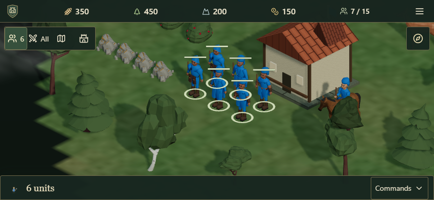
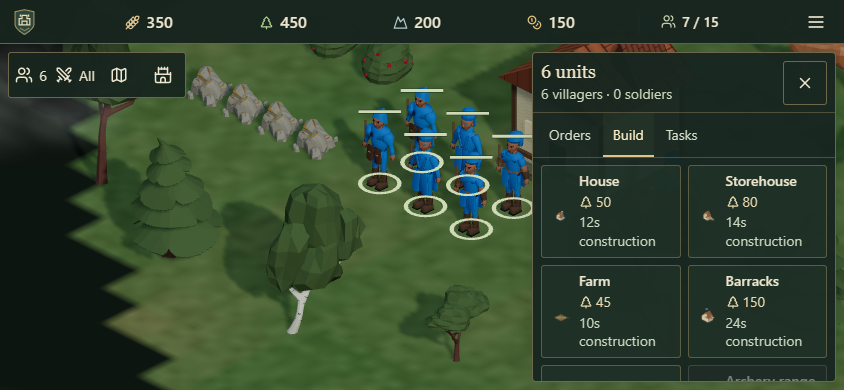

# Compact in-game HUD verification

The in-game interface now keeps resources at the top and selected-entity commands at the bottom on desktop. Phone/tablet controls open on demand: a bottom sheet in portrait and a right drawer in short landscape. Choosing a targeted order or building closes the drawer before placing it on the battlefield.

The supplied Age of Empires II/III screenshots informed the resource / selection / command / minimap hierarchy. Additional research: [Kevin Hustler, principal UX designer on Age of Empires IV](https://kevinhustler.me/aoe4), especially reducing permanent HUD space, discoverable building choices and text scaling. Ironvale retains its own artwork, colors and game rules.

## Reachability

- Workers: Commands → Orders / Build / Tasks. Every construction option remains in a scrolling list, with costs and times.
- Buildings: Train / Improve / Manage as applicable; production queues stay visible across tabs. Move/remove confirmation, market exchange, farmer assignment, garrison release, wall upgrades and capital rebuild remain available.
- Map, compass camera tools, Realm status and tutorial details open separately. Realm status retains the world clock/weather, city colors, teams and zombie phase on compact screens.
- Game menu: Resume, Settings, single-player Save/New match, Help, Realm status and exit. Online games continue while menus are open.
- Joined voice has a persistent Muted / Mic on button for immediate control, including over menus; expanded voice and other panels share the same overlay state. Voice transport and privacy rules are unchanged.
- Controls use 44px minimum touch targets; action labels are at least 14px. Settings retains the Larger text option. Tabs support arrow/Home/End navigation, and Escape dismisses open controls without interfering with button activation.

## Checks

`npm test`: 319 tests passed across 40 files. `npm run check`, production build and whitespace validation passed. Across the two selected browser scopes, the latest result for each scenario is 79 passed, 14 intentionally skipped, and no remaining failures. The final scope itself completed with 63 passed and 12 skipped. [Machine-readable results](compact-hud-evidence/browser-results.json) list every scenario. The initial short-move worker timing assertion was corrected and rerun successfully on all devices.

The baseline phone check measured only 39% of sampled screen points accepting battlefield input after selecting workers. The new regression requires at least 70% in every tested layout with Commands closed. It samples actual hit targets rather than subtracting panel rectangles. It also physically checks control centers, scrolls to the last build option, places an actual house, and verifies its population increase.

Tested layouts: desktop 1440×900; phone 390×844 and 844×390; tablet 768×1024 and 1024×768, plus the existing device presets. Additional flows cover recruitment, advancement, smithy research, wall upgrades, market exchange, move/remove, worker task persistence/resumption, save, tutorial, larger text, camera/minimap, zombie rendering and online mode settings. Online voice uses simulated microphones with real local WebRTC transport, including channel isolation and quick mute in both orientations.

The final production check at http://localhost:8180 returned a healthy server and no browser errors. Sampled battlefield input area with Commands closed was 74% on desktop, 84% on phone portrait, 71% on phone landscape, and 85–86% on tablet. [Local runtime measurements](compact-hud-evidence/local-runtime.json) retain the exact values. The desktop context dock was expanded during its measurement.

## Evidence and limits

Screenshots and the compact result summary are in [compact-hud-evidence](compact-hud-evidence/). Mobile tests emulate touch and screen dimensions in desktop Chromium; physical iOS/Android and public-internet voice calls were not verified. No public deployment was performed. Earlier performance/AI/model verification remains in the existing reports; this change does not alter simulation timers, assets or game physics.
