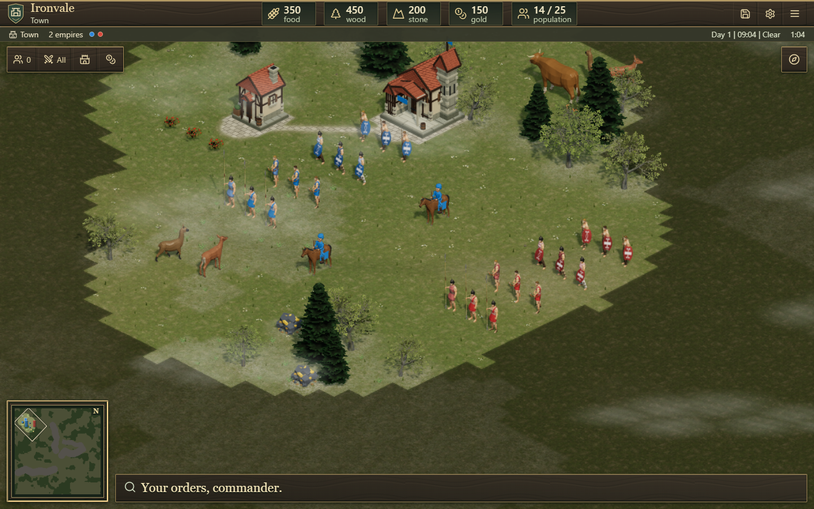
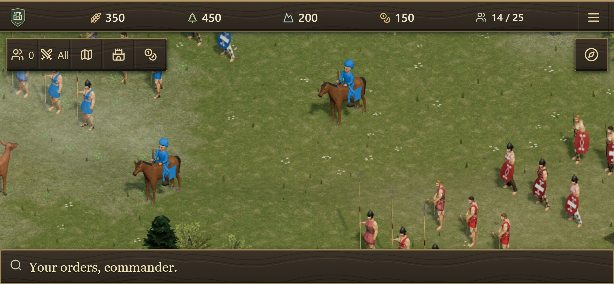

# Historical artwork and battlefield tactics

This update selectively adapts 0 A.D. artwork into Ironvale's existing renderer
and adds original terrain-aware combat rules. Multiplayer remains server
authoritative. Teams retain independent resources and no friendly fire; voice
channels and optional night zombies use their existing systems.

## Artwork integrated

- Spearmen, swordsmen, archers and pikemen use native meshes, heads, clothing,
  weapons and native skeletal animation clips. Each class has three deterministic
  appearance variants and eight city palettes. The native long-pike attack uses
  its own two-handed animation. Other troop types keep their previous providers.
- Authored cloth and shield masks receive city colors. Skin, hair, leather and
  metal retain their original texture art. The converter respects authored head,
  helmet, shield and weapon attachment transforms.
- Two oak meshes, one pine and one berry bush use original foliage atlases.
  Six tree profiles preserve source proportions. Berry bushes remain food
  resources under the ordinary carrying and drop-off economy.
- 35 command portraits were regenerated locally from the actual model providers:
  32 infantry/city combinations, wood, berries and the existing CC0 gold model.
- Approved medieval buildings/walls, animals, random raised terrain, map sizes,
  team placement, weather and day/night rules remain available.

## Source and licensing

The requested [Gitea repository](https://gitea.wildfiregames.com/0ad/0ad) could not
be read through the browsing tool because of its access checks. Sources were
retrieved from the official archived GitHub mirror at fixed commit
`61a3b9507d974084e6badb88a0826bd89a6d5b8b`; this is not a claim to track the latest
Gitea revision. See [character notices](../public/models/historical/README.md),
[foliage provenance](historical-nature-provenance.md) and
[asset credits](../THIRD_PARTY_ASSETS.md). Manifests record exact source URLs,
SHA-256 hashes, outputs and modifications. Wildfire Games artwork and derivative
poses, maps and portraits retain CC BY-SA 3.0 attribution and licensing.

The custom infantry assemblies combine selected source parts rather than
reproducing a complete original faction. Rebuild with Python, numpy and Pillow:

```powershell
python scripts/prepare-historical-characters.py
python scripts/prepare-historical-scenery.py
npx tsx scripts/bake-command-portraits.ts --historical
```

## Combat behavior

The official mirror's `simulation/components/Attack.js` informed review of
target preferences, hostility and projectile geometry. Ironvale's implementation
is original TypeScript; no 0 A.D. engine, GPL simulation component or faction
template was copied.

Ranged reach grows by 5% of base range per world unit of downhill advantage,
capped at 20%. Uphill shots receive no bonus; melee ranges and damage are
unchanged. Acquisition searches the maximum possible range, then validates the
actual target's height. The Orders panel explicitly labels the potential range
as **up to** that amount.

Only mountain terrain intercepts shots. Exact tile-edge and mesh-diagonal
interval checks avoid missing a narrow ridge crossing. Trebuchets use an arc;
other ranged attacks use a straight clearance line. A blocked shot consumes no
attack cooldown. Mobile attackers approach around the obstacle through ordinary
navigation; hold-position units remain stationary. Damage still resolves
deterministically, with existing visual projectile effects rather than a new
miss/ballistics simulation.

Automatic targeting prefers nearby class counters after hostility, scouting,
range, garrison and defensive-home checks. Spears/pikes prefer mounted units,
cavalry prefers ranged infantry, and archers prefer spear/pike infantry. Explicit
orders—including committed town-hall attacks—retain their target. There is no
resource subsidy, training-speed multiplier or new friendly-fire path.

## Rendering bounds

Native actor clips are sampled offline to eight shared phases. Crowd mode uses
two of those phases, without creating another geometry bank. Runtime lookups
reuse prepared geometry, materials and arrays; no per-unit skeletons or animation
mixers are allocated. Eighteen actor maps are shared across city palettes.
Foliage uses alpha-tested cards with depth writing instead of blended sorting.
Both providers dispose owned resources and retain existing models as a load
failure fallback. Asset loading finishes safely after a view is destroyed.

The actor binary is 9,136,896 bytes; foliage meshes/maps total 931,056 bytes.
These are additional locally served assets. Bounded caching is not a guarantee
of a particular frame rate on every device.

The existing 800-troop simulation benchmark completed 1,200 ticks at a 2.97 ms
mean and 6.74 ms p95 against the 50 ms tick budget. Its maximum was 223.05 ms,
so this does not claim every tick stays below budget. This measures simulation
work on this computer, not graphics frame rate or physical-phone performance.
See [timing report](historical-realm-evidence/simulation-800-performance.json).

## Verification

The full simulation/asset suite passed **569 tests**. Coverage includes native
pose geometry and attachments, class/appearance/city diversity, crowd sharing,
source hashes, alpha-tested foliage, disposal/failure handling, downhill bounds,
thin-ridge interception, siege arcs, automatic counters, explicit capital orders,
allied hostility and deterministic save/replay. See
[unit results](historical-realm-evidence/unit-results.json).

Browser results and production runtime captures are recorded in this evidence
folder. The first regression run passed 32 tests, skipped five project-specific
cases and exposed two errors in the new comparison-scene selection check: its
leftmost archer was beneath the compact toolbar. The corrected check navigates
through the normal minimap before selecting that soldier. No gameplay or hit
testing change was needed for that test correction.

After correcting compact navigation and accounting for integer minimap pointer
coordinates, the latest result for each exact test/project combination is
**35 passed, seven deliberate project skips, zero remaining failures**. The
[combined summary](historical-realm-evidence/browser-summary.json) retains links
to all raw runs, including initial failures and successful focused reruns.
Checks cover native art in day/night, city colors, shared asset bounds, readable
selected-unit tactics, touch control accessibility, building relocation/removal,
night raids/day retreat, online zombies, uneven teams/reconnects, independent
resources, real local open/team-private WebRTC audio, mute/unmute, FFA voice and
lobby-to-match voice continuity.

The production build passed TypeScript, Vite and server bundling. Its pre-existing
graphics bundle remains above Vite's 500 kB advisory size threshold. The actual
local production server at **http://localhost:8180** passed health, native asset
serving and WebSocket welcome checks, with no page/console errors in the runtime
capture. See [runtime report](historical-realm-evidence/local-runtime.json) and
[build output](historical-realm-evidence/build.txt).





Prepared character comparison scenes place ordinary troops on seed42 generated
land with normal HP, hold stance and explicit scouting. They demonstrate artwork
and city colors, not an unmodified new-game opening. Phone/tablet checks use
Chromium emulation on a desktop GPU. Voice checks use synthetic microphones and
real local WebRTC transport; physical devices, public internet TURN routing and
external hosting are outside this verification.
