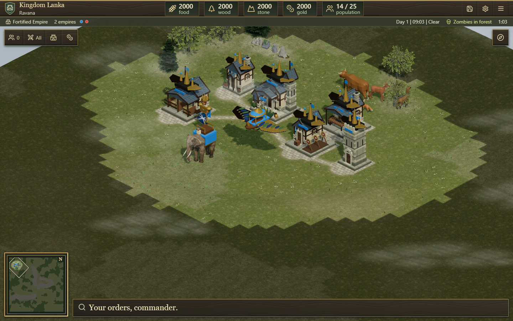
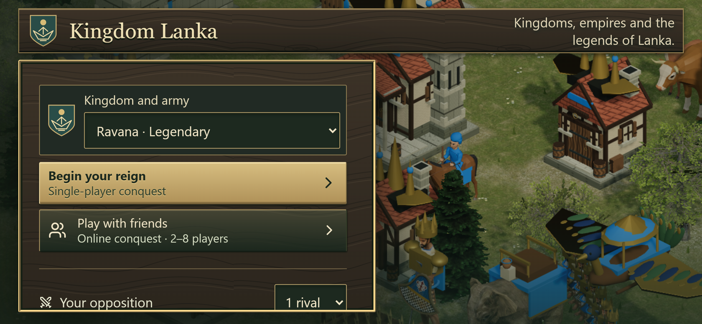

# Kingdom Lanka verification

The renamed game includes ten selectable historical/legendary factions, six new
troop classes, faction specialties, regional army art, distinct city adornments,
native Asian elephant animations and matching unit/capital portraits. See the
[faction design and research](kingdom-lanka-design.md) for exact rules and
historical/legendary boundaries.

## Verified locally

- **612 simulation/asset/UI tests passed** in the final full suite, using two
  workers. [Full results](kingdom-lanka-evidence/unit-results.json).
- **47 distinct browser scenarios passed**, with nine intentional project skips
  and zero remaining failures. The [combined summary](kingdom-lanka-evidence/browser-summary.json)
  identifies each exact scenario/project and links all raw runs. It uses the
  latest focused result when a corrected test supersedes an earlier failure;
  it does not hide the initial raw failures or use automatic retries.
- TypeScript, browser production bundling and multiplayer worker/server bundling
  passed. [Build output](kingdom-lanka-evidence/build.txt). The existing Three.js
  graphics vendor chunk remains above Vite's 500 kB advisory threshold.
- An **800-troop, eight-faction** synthetic simulation ran 1,200 ticks at
  **4.29 ms mean / 10.21 ms p95**, against the 50 ms tick budget. The maximum was
  **204.32 ms**, so this does not claim every tick meets budget. Troops were
  directly spawned for a stress test, bypassing housing/recruitment; these
  numbers measure simulation CPU time, not GPU FPS or phone performance.
  [Timing report](kingdom-lanka-evidence/simulation-800-performance.json).

## Functional coverage

Faction tests cover all ten rosters; real costs, age unlocks and training times;
weighted population and queued reservations; faction construction/market/combat
modifiers; AI using the same validated production path; deterministic solo AI
faction assignment; caller-config immutability; neutral legacy compatibility;
and deterministic save/restore.

Flight tests cover water/mountain traversal, air formations, ranged-only
anti-air targeting, elevation-aware projectile clearance, bounded effect-height
serialization, no airborne occupation/garrison/resource work, and zombies
ignoring unreachable aircraft. Mounted troops, pikes, firearms and cannon use
explicit counters. A browser check selects and moves Dandu through ordinary
commands and confirms its population/airborne information.

Network tests cover untrusted faction validation, self-only choice, readiness
resets, no switching during a live game, varied AI fill, public queue retention,
uneven teams, independent resources, refresh/reconnect, AI takeover and checkpoint
consistency/tamper rejection. Browser checks confirm distinct host/guest factions
through match start/reconnect and recheck uneven-team behavior.

Existing real local WebRTC audio tests passed: open versus team-private channels,
mute/unmute, stopped microphone tracks, FFA voice, lobby-to-match continuity and
compact quick controls. Zombie checks passed for neutral night raids/day retreat
and shared online settings. Worker/building management, contextual commands,
training/research, wall upgrades, large text and mobile access also passed.

Asset checks use the actual local native geometry, sampled poses, textures,
source hashes, owner palettes, finite resource banks, shared repeated lookups,
equipment/animation differences and disposal—including destruction while loading.
The local baker generated **1,040 faction-prefixed portraits**, including native
large-unit silhouettes and actual capital crowns, with attribution in their
[manifest](../public/art/portraits/lanka-manifest.json).

## Issues found and corrected

The initial browser probe exposed asset-bank selection before a battlefield
received its first snapshot. The view now receives player factions before
initialization. Independent review then found that a legacy save followed by
**New match** reused its legacy-only model bank; the view now remounts when the
required legacy/regional bank family changes. Both transitions passed browser
regressions.

The aircraft test initially expected a tile corner while normal orders snap to
tile centers. It now clicks and checks tile centers. An online selector also
matched the menu underneath its overlay; the underlying menu is now inert and
hidden from assistive technology, the lobby has dialog semantics, and its test
targets the visible dialog. The corrected online faction/reconnect check passed.

## Production preview and practical limits

The local combined production server runs at **http://localhost:8180**. The
runtime report and captures in this evidence folder verify the built game rather
than a design mockup. The server was refreshed only after confirming the prior
task-owned preview had zero rooms. No public deployment, push or commit was made.

The [production runtime report](kingdom-lanka-evidence/local-runtime.json) confirms
healthy service, WebSocket welcome, native asset/notice/portrait responses and
zero page/console errors across seven prepared city captures. The regional bank
reports 1,692 shared geometries, 44,813,568 geometry bytes, 81 materials, 12
textures, 76,800 finite pose/owner/faction lookups and zero live animation mixers.
These are cached resource counts, not per-unit allocations or an FPS claim.

The final landscape-only menu adjustment removes the repeated headline and
lengthy specialty copy from short screens. A separate actual-production
[phone landscape check](kingdom-lanka-evidence/phone-landscape-menu.json) confirms
both play buttons are fully visible and receive input without scrolling at
844 × 390. Each remains over 44 pixels tall. Portrait setup and Help retain the
specialty descriptions; Ravana's option remains labeled Legendary.

Prepared army/city comparison scenes use ordinary troop HP, normal rules, a
generated seed42 map and a deliberately developed age-three city. They are not
unmodified new-game openings. A separate ordinary-start capture uses normal
British opening resources and units. Phone/tablet checks use Chromium emulation
on a desktop GPU. Physical-device rendering, public internet voice/TURN routing
and production balance win rates were not measured.

Original building/wall behavior, random raised maps, animals, day/night and
weather remain. The city and uniform art is an interpretation rather than an
exact historical reconstruction. Ravana's giants and peacock craft are labeled
legendary. Dandu carries no passengers. This update does not claim to port the
entire 0 A.D. engine or surpass Age of Empires in every feature or visual detail.

All selected 0 A.D. artwork and derivative portraits retain Wildfire Games
attribution, provenance and CC BY-SA notices. No notices were removed and no
unlicensed engine code was copied.

