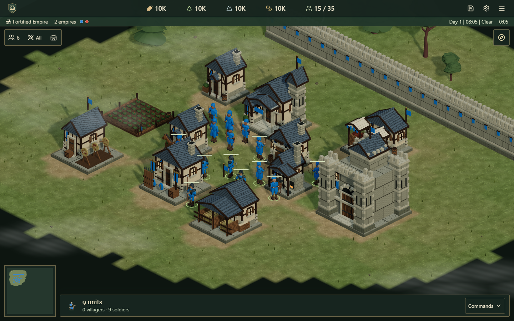
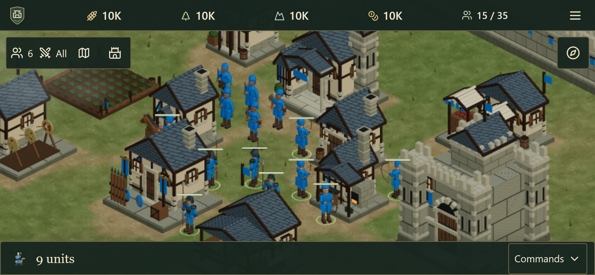

# Detailed medieval overhaul

This delivery makes the existing Ironvale battlefield visibly more medieval and adds formation destinations and production rally points. It follows the detailed medieval direction chosen by the user on 2026-10-16. The supplied references informed architecture, terrain variation, city proportions and military ranks; all new building geometry and procedural textures are original. Reference research also used the official [economy/control guide](https://www.ageofempires.com/learn-to-play/control-resources-aoe2/) and [military/economy guide](https://www.ageofempires.com/learn-to-play/military-and-economy-aoe2/).

## Playable changes

All sixteen building types have a new original architecture provider. Timber framing, shutters, chimneys, tiled roofs, stone foundations, courtyards, market stalls, a forge, crop rows, wall crenellations and a moving portcullis replace the earlier simple buildings. Age-dependent variants and eight city colors remain distinct. Geometry is shared across owners and static material groups are merged; the finite full cache is approximately 10.4MB of geometry plus 1MB of material pixels before mipmaps. Imported fantasy buildings remain disabled.

The terrain combines the existing licensed ground photograph with original soil/grass variation and cosmetic settlement paths. Ground cover is bounded and rendered in two instanced meshes; it updates when visibility or settlement surfaces change. Hidden terrain receives no new surface information. Infantry and mounted visual proportions are adjusted, with unchanged simulation footprints, existing army/animal assets and camera projection.

Army Orders includes Line, Box and Spread. Destination slots are deterministic, distinct, reachable through known terrain and ordered with melee ahead of archers and siege. Large Line formations use multiple ranks. These are destination formations, not rigid formations maintained throughout marching or combat. Worker task stacks keep their earlier behavior.

Production buildings offer Set rally point and Clear rally point in Train. New recruits move to the flag; new villagers gather from a valid visible source or owned completed farm. Stale sources safely fall back to the saved position. Costs/timers are unchanged. Rallies and formation choices persist through saves and online reconnects, and remain private to their owner.

Movement can end at a reachable perimeter instead of remaining permanently active at a blocked goal. If an unseen wall prevents the entire route, units move toward the closest reachable frontier and reveal it normally. AI reachability tests remain strict so siege/breach decisions continue working. Private navigation routes are omitted from snapshots; full routes remain in authoritative state and saves.

## Verification

**372 tests passed across 44 files.** The broad browser run passed 72 scenarios with 15 intentional skips. The final control/movement/rendering pass passed 12 scenarios with 6 intentional skips; these duplicate selected scenarios from the broad run. There are 72 distinct passing browser scenarios and no remaining failures. Typecheck, production build and whitespace checks passed. [Machine-readable browser results](medieval-overhaul-evidence/browser-results.json) preserve the selected scenarios. Unit coverage includes old/current saves, ownership, malformed commands, paid recruitment, worker memory, enemy snapshots, unseen building changes, blocked destinations, patrols, wall breach decisions, formation shapes and geometry/resource lifetimes.

The browser checks cover real rallies, resource gathering by recruits, formation orders and arrival, reverse building-selection order, online reconnects and separate resources, mobile portrait/landscape Commands, larger text, world picking after rotation, touch gestures, wall upgrades, moving/removing buildings, worker saves/resumption, zombies and bounded large-army rendering.

## Scope and limits

The new graphics are a substantial medieval pass in the existing browser engine. Characters and natural scenery retain their stylized licensed assets. Rivers, bridges, naval warfare, fourth-age progression, civilization-specific technology trees and campaigns are not included. Existing teams, voice, zombies, weather, building management and conquest rules are preserved. There is no claim of full Age of Empires parity.

Mobile verification uses desktop Chromium touch/device emulation, not physical iOS/Android devices. Rendering measurements use controlled fixtures with large armies and delayed AI decisions; they are not physical-phone or full production battle benchmarks. City showcase screenshots use controlled fixtures with prepared buildings/resources; ordinary new-match starting resources are unchanged. No public deployment, purchase or new external asset pack was performed.

## Measured performance and previews

The final controlled rendering checks measured about 60 FPS on desktop at 400/800 units, and about 60/57 FPS at the emulated phone viewport. These run on the desktop Intel GPU, not phone hardware. The [largest-map formation benchmark](medieval-overhaul-evidence/formation-performance.json) records eight runs per size, with a median around 4ms for 100 troops and 3.5ms for 800 troops against a complete wall. All destinations were unique and on the reachable side.

[The local production runtime check](medieval-overhaul-evidence/local-runtime.json) records a healthy server and playable desktop/mobile dimensions. Ordinary new-game previews are also saved beside these controlled city fixtures.
