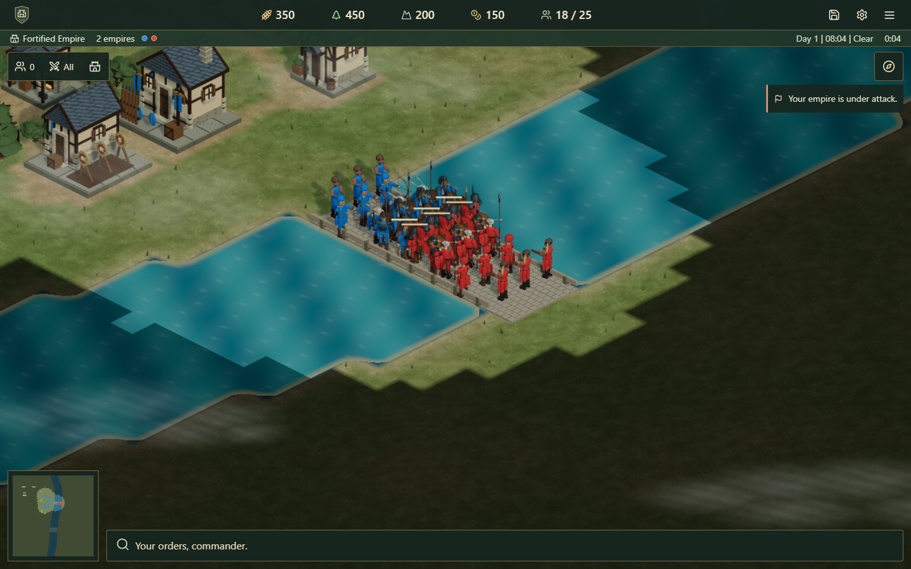
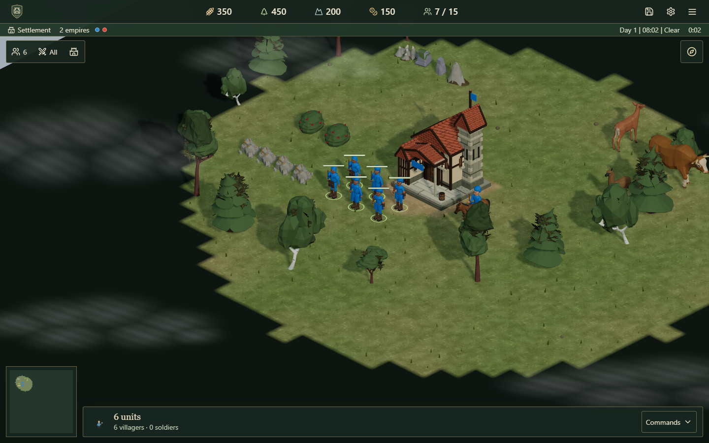
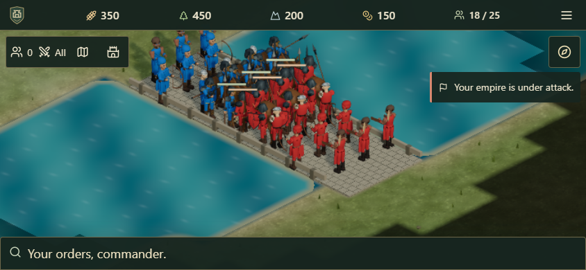

# Riverlands and living battlefields

This phase follows the user's request to keep the approved buildings and continue toward detailed medieval cities and battles. The existing building provider and animal artwork are unchanged. All new geometry and river/bridge textures are original; woodland sprigs reuse the already licensed local Poly Haven photographs.

## Playable changes

Choose **Riverlands** or **Lowlands** in single-player setup, private room setup/host settings, or public matchmaking. New menus explicitly select Riverlands; omitted settings and older saves retain Lowlands. Public queues separate map types, teams and zombie settings. Map choice survives authoritative starts, host edits, checkpoints and reconnects.

Riverlands generates a broad winding river with a permanent three-tile-wide stone bridge and five-tile-wide shallow crossing. Deep water blocks every land unit, including workers, animals and zombies. Movement, formations and crowd displacement use the same water mask. Construction and relocation reject water and permanent crossings. Starting city/resource neighborhoods stay dry, and land remains connected across the river. Lowlands generation and its random stream retain exact legacy hashes.

Recruitment waits for a dry exit. Garrison release uses a local face-adjacent perimeter and cannot teleport troops across water or surrounding walls. Enclosed garrisons remain inside; survivors of a destroyed enclosure emerge on its former dry footprint. Saved routes, defensive homes and placements are validated against water. Placement previews and authoritative rejection messages require full-footprint scouting before checking hidden terrain or occupants.

The river has animated flow, restrained highlights and rain ripples tied to the existing shared world clock. Fog masks hide unexplored water/crossings and dim remembered areas. Shores use only known neighboring terrain. The minimap distinguishes water, shallow crossings and stone bridges. Grass and pebbles stay off water and crossings.

Woodland has twelve bounded species/size silhouettes with photographic sprigs. Bows draw, crossbows reload, workers chop and mounted troops strike using the existing six-frame shared pose banks. Units turn smoothly toward movement or visible work/attack targets. Pooled directional arrows and arcing siege stones replace the old identical projectile spheres. These effects do not change attack damage, cooldowns or resource rules.

## Performance

Tile-neighbor relationships and coordinate trigonometry are calculated once per tile/coordinate instead of once per subpixel. In the local 192×192-map microbenchmark, warm median terrain-control-texture generation fell from **94.25ms to 20.94ms**, about **4.5 times faster**. Whole-map and mixed-fog/path output hashes are identical before and after this optimization. This measures that CPU operation, not an equivalent whole-game FPS gain. [Raw timings and pixel hashes](riverlands-evidence/terrain-performance.json) record the fixture and limits.

Water uses one lightweight pass, and bridge components use three shared instanced batches. Each photographic tree overlay adds 36 triangles; twelve finite templates can add up to twelve canopy batches. Character poses remain shared, with no per-entity rigs. Projectiles use two batches capped at 128 per kind on small screens or 256 on desktop. The menu vista renders at 24fps and suspends drawing behind its lobby/settings/help overlays; interactive matches keep their normal animation cadence and adaptive quality.

## Scope and evidence

This is a landscape and battle-presentation step in the existing browser RTS. Naval units, destructible bridges, civilization-specific technology trees and campaigns remain outside this phase. Teams, city colors, private resources, voice, optional zombies, worker task memory, weather, conquest and fair AI costs/timers stay in use.

Browser phone/tablet checks use desktop Chromium emulation, rather than physical devices. Ordinary new-game screenshots retain normal starting resources. Battle/city showcases use prepared cities and armies with increased hit points so the scene can be inspected; they are not ordinary starting positions or production battle benchmarks. No external asset pack, purchase, publication or Git push was performed.

## Verification results

**417 automated tests passed, with no failures or skips.** The production build and TypeScript checks passed. Coverage includes deterministic connected maps for 2–8 empires/unequal teams, legacy world hashes, water-safe movement/formations/spawns, garrison release, building actions, fog, invalid saves/settings, map-specific queues, checkpoint/reconnect, model lifetimes and rapid lobby changes. [Unit results](riverlands-evidence/unit-results.json) retain the full run.

**132 distinct browser cases passed; 30 cases were intentionally skipped for nonapplicable devices. No failed cases remain in their latest execution.** [The merged summary](riverlands-evidence/browser-summary.json) links each case to its latest raw report. The broad run crossed verified Windows sleep/hibernation and interrupted two weather cases; both passed on rerun. The eight-client setup originally exhausted its existing timeout while opening background scenes, then passed in **36.18 seconds** after the rendering budget change. A rapid host-settings race found during the map rerun was fixed and verified with delayed/ABA/rejected/reconnect client regressions and the final real-browser lobby/voice pass. Raw reports preserve the earlier failures and subsequent passing executions.

Browser checks cover bridge marching, water construction rejection, solo map changes, room/public matchmaking, online zombie settings, eight clients, unequal teams, separate resources, reconnects, worker tasks, rally/formation commands, moved/removed buildings, wall alignment/upgrades, touch/rotation/picking, readable portrait/landscape HUDs, optional asset failures, day/night/rain and real WebRTC open/team audio with microphone/incoming mute. GPU-call instrumentation confirms the menu stops drawing behind the lobby and resumes on close on desktop, phone and tablet.

Controlled 400/800-unit rendering measured **59.5/60.0 FPS on desktop** and **52.2/52.2 FPS in the phone viewport with 4× CPU throttling**, on the desktop Intel UHD GPU. Phone render scale adapted to approximately 0.85/0.75. These are desktop emulation measurements, not physical-phone guarantees or full Riverlands simulation benchmarks. Raw desktop/phone performance files are alongside the screenshots.

The final [local runtime check](riverlands-evidence/local-runtime.json) confirms `http://localhost:8180`, healthy protocol 1 with zero rooms left by verification, authoritative rapid map/zombie edits, a live bridge battle with damaged troops and no browser errors. The tested phone portrait/landscape layouts kept over 70% of sampled screen points available for battlefield input. The previous known idle server was refreshed without interrupting an active room.

